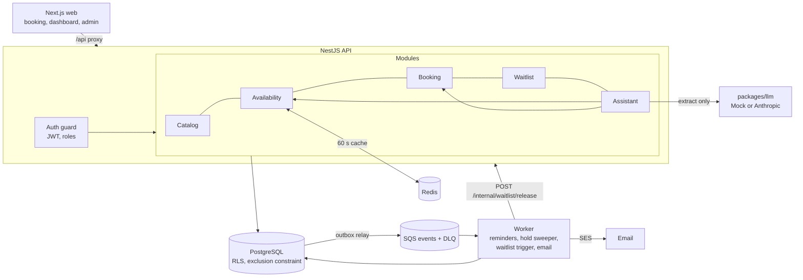

# Architecture

SlotFlow is a modular monolith plus one worker (ADR-001). Postgres is the source of truth; everything asynchronous is
derived from it.

## Request path of a booking

1. The guard resolves tenant, role and customer from the token (or headers in `dev` mode).
2. `BookingService.place` opens a transaction with `app.tenant_id` set, so RLS applies.
3. It inserts the booking and one `booking_resources` row per staff member and room, in `resource_id` order, with a
   `tstzrange`. The exclusion constraint rejects any overlap on active rows; the loser gets 409 and may try another
   staff/room combination.
4. The outbox row is written in the same transaction; commit makes both visible.
5. The relay publishes to SQS (publish first, mark after: duplicates are possible, losses are not); consumers rebuild their
   work from the booking's current state, so duplicates and reordering are harmless.

## Where each guarantee lives

| Guarantee               | Mechanism                                                                                          | ADR |
| ----------------------- | -------------------------------------------------------------------------------------------------- | --- |
| No double booking       | `EXCLUDE USING gist (resource_id WITH =, time_range WITH &&) WHERE status IN ('held','confirmed')` | 002 |
| Tenant isolation        | RLS forced on every table, `app_tenant_id()`, non-superuser role                                   | 003 |
| Correct local time, DST | Hours stored as local time per branch; engine in `packages/core` with DST rules                    | 004 |
| Holds that expire       | Expiry handled inside the booking transaction plus a sweeper                                       | 005 |
| Reliable notifications  | Outbox, SQS with backoff and dead letters, delivery re-checks state                                | 006 |
| Fair waitlist           | An offer is a real hold; FIFO; the API decides, the worker only triggers                           | 007 |
| AI cannot act alone     | Extraction only; server-side confirmation; templates                                               | 008 |
| Who may do what         | Role rule table, per-branch and per-customer checks                                                | 009 |

## Packages

- `packages/core`: pure domain code (availability engine, cancel policy, state machine); no I/O, so it is unit and
  property tested.
- `packages/llm`: provider interface, `MockProvider`, `AnthropicProvider`, Zod schema, eval sets.
- `apps/api`, `apps/worker`, `apps/web`, `e2e` (Playwright).
